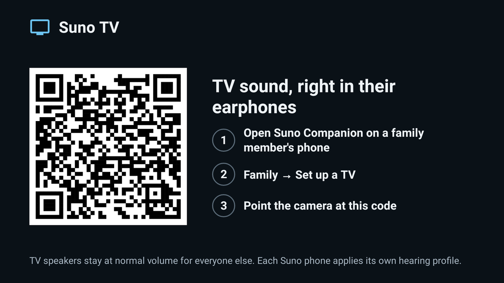
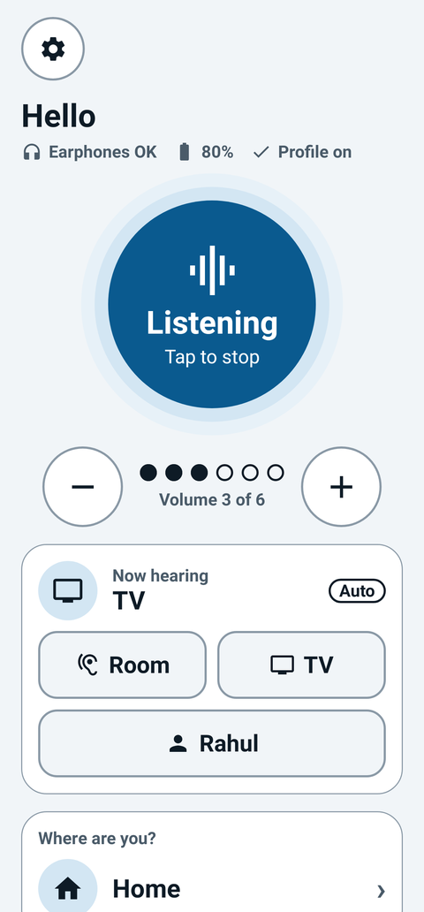

# Suno

Suno ("listen" in Hindi) is a free, open-source Android app that helps elderly people, and children and adults with
neurological or cognitive disabilities, hear better. It works fully offline.

- Makes sound louder and clearer using the person's own audiogram.
- Brings voices closer: family members talk from their own phones, and TV sound streams straight to the earphones.
- Very simple screens for the person being helped, with an SOS button and large call screens.
- Separate apps for family and carers, and for TVs.

Suno is a sound-amplification tool. **It is not a medical device** and does not replace a hearing professional.

## Status

Early development. Phases 0–4 are built: the EarCast code base imported, renamed and split into three apps with
safety fixes; the patient's simple Home with a helper PIN; the family link, where a companion joins by QR and talks to
the patient; TV sound, sent from a phone by cable or from the Suno TV app, set up by a family member's phone; and SOS,
which alerts family phones and the TV, calls the helper and texts the patient's place, with a relay for phones out of
range. The architecture, decisions and build plan are in [arch.md](arch.md). Nothing has been validated
on real hardware yet.

## Build

Requirements: Android SDK with platform 37, NDK 30.0.16248370 and CMake 4.1.2 (set `sdk.dir` in
`local.properties`). Gradle downloads JDK 27 itself.

```bash
./gradlew ktlintCheck detekt test testPatientDebugUnitTest
./gradlew assemblePatientDebug assembleCompanionDebug assembleTvDebug
```

| App | Package | Build output |
|---|---|---|
| Suno (patient) | `au.remotiq.suno` | `app/build/outputs/apk/patient/debug/` |
| Suno Companion | `au.remotiq.suno.companion` | `app/build/outputs/apk/companion/debug/` |
| Suno TV | `au.remotiq.suno.tv` | `app/build/outputs/apk/tv/debug/` |

<p>
  
  
</p>

## Privacy

Suno is designed to work without internet, an account, analytics or recordings. Sound moves only between nearby
devices that the user has approved, over Wi-Fi Direct or Bluetooth, and every frame is encrypted. The patient,
companion and TV apps declare the `INTERNET` permission only because Android requires it for any network socket, including the
local Wi-Fi Direct group; Suno makes no internet connections. A companion can only send its voice; nobody can listen
through the patient's phone. In an SOS the patient's phone texts its GPS place to the numbers the helper chose, through
the phone's own SMS.

## License

Suno is free software, licensed under the [GNU General Public License v3.0 only](LICENSE) (`GPL-3.0-only`).
Bundled third-party libraries and models keep their own licences.

## Credits

Suno is based on [EarCast](https://github.com/octavian-negru/ear-cast) by Octavian Negru (GPLv3), which was
inspired by [OpenHearing](https://github.com/HMAKT99/OpenHearing).
